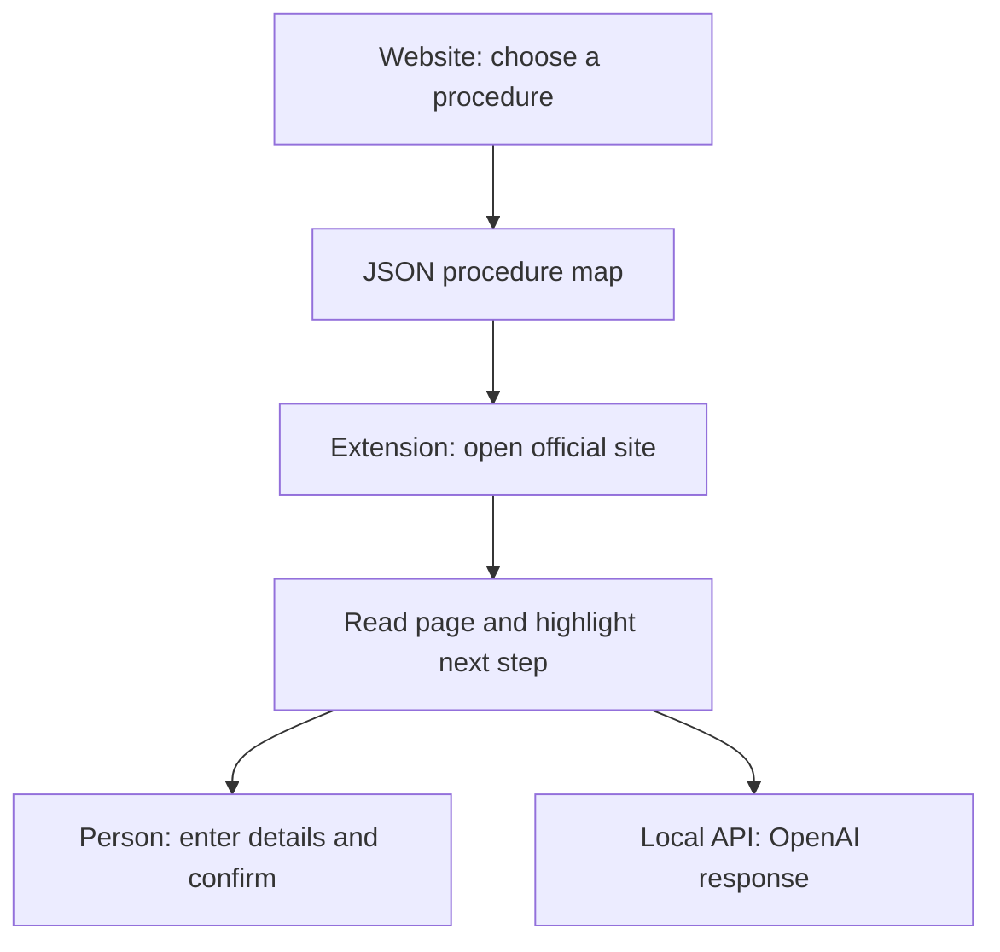

# OrientaT · A guide to public services

**Find a public service procedure, then get guidance while completing it on the official website.** OrientaT is a prototype built at **DevDay Exchange Community: Barcelona** on **November 21, 2026**. It combines a discovery website with a Chrome extension that opens the relevant government website, reads the current page, and guides the next step. The person enters their own data, reviews the result, and confirms any submission, signature, or payment.

> Independent prototype. It is not a government service and is not affiliated with the Spanish government or OpenAI. Always verify current requirements and deadlines on the official website.

The project addresses a practical problem: public service procedures are spread across portals, calls for applications, eligibility rules, and forms. Our demo shows how contextual guidance can help people navigate these pages while leaving decisions with them. In the longer term, a government could maintain its own maps and assistants with sources and models under its control. That infrastructure is outside this prototype.

## The hackathon and team

The event took place on **Saturday, November 21, 2026, from 10:00 to 17:00 at Itnig Café, Carrer de Pujades 100, Barcelona**. The [Codex Community Events listing](https://luma.com/0ly6gnti) invited teams of three to five to build with Codex and ChatGPT, with themes announced on the day, OpenAI engineers on site, live demos, and prizes. [Itnig also published the event details](https://itnig.net/en/events/9d2e128c-6c3a-474b-ad4a-7fefddcc8123/). Our team built this approach to public service guidance:

| Team member | X account |
| --- | --- |
| Nuria | [@user_nuria](https://x.com/user_nuria) |
| Sergio | [@sergiogomezmm](https://x.com/sergiogomezmm) |
| Sergi | [@Sergimcc](https://x.com/Sergimcc) |
| Guillermo | [@GuilleVillarSan](https://x.com/GuilleVillarSan) |
| Alejandro | [@alegoml](https://x.com/alegoml) |

## What you can try

| Component | What it does | Current state |
| --- | --- | --- |
| Website | Catalog based chat, plans for mapped procedures, and a handoff button to the extension. It uses local logic and repository content. | Works without an AI key. |
| Chrome extension | Side panel on the official site. It reads the page, follows links, and highlights the next control. Its agent can use OpenAI through the local server or an Anthropic key configured in the browser. | Requires loading `dist/` and configuring a provider. |
| Voice | Speech input and output in the website and side panel. | Optional; requires ElevenLabs configuration and microphone permission. |

The two featured journeys are **booking a Spanish ID card or passport appointment** and **finding an affordable rental home on Casa 47 and starting an application**. Both maps in `plugins/` have **draft** status. The ID appointment journey was observed up to the document details screen without submitting it; later screens must be read live. The Casa 47 map covers the public browsing journey and a specific application action, but availability, application rules, and the link between a property listing and its application can change. The demo does not complete a real appointment or application.

The website supports Spanish, Catalan, Basque, Galician, and English.

### How the pieces connect



The same `plugins/*.json` maps supply the website's extension catalog and the extension's guidance. `mappings/casa47/` contains detailed exploratory notes. The website currently uses `MockTramitesTransport` for predefined catalog based replies; it does **not** automatically call `/api/chat`. The Vite development server exposes `/api/extension` for the side panel and keeps `OPENAI_API_KEY` out of the Chrome bundle. Do not type identity numbers, passwords, or private information into the chat. For the ID form, the person may enter details on the official page or in the side panel form, which copies them onto that page. The person handles the CAPTCHA and submission.

## Run the demo locally

**Requirements:** Node.js 20.19+ or 22.12+, npm, and Chrome 120 or newer. From the repository root:

```powershell
npm ci
npm --prefix web ci
npm run build
```

To obtain **extension** agent responses through OpenAI, copy [`web/.env.example`](web/.env.example) to `web/.env.local` and set `OPENAI_API_KEY`. You can set `OPENAI_MODEL` and `OPENAI_SERVICE_TIER` to control the model and processing tier; check your account's pricing and quota. Git ignores `web/.env.local`. The website catalog works without a key, but the OpenAI agent in the extension does not. Voice additionally requires `ELEVENLABS_API_KEY` and, optionally, `ELEVENLABS_VOICE_ID`.

Start the website and local extension API:

```powershell
npm --prefix web run dev
```

Open <http://127.0.0.1:5173/>. In `chrome://extensions`, enable **Developer mode** → **Load unpacked** → choose this repository's **`dist/`** directory. If you previously loaded another build, click **Reload** on the extension card and refresh the website tab. On Windows, [`abrir-web.cmd`](abrir-web.cmd) can install the website dependencies, start the server, and open Chrome; run `npm run build` separately to prepare the extension.

**One minute demo:** open the website, choose the Spanish ID appointment procedure, inspect its plan, and click the handoff button. On the official website, use the side panel to show how it identifies the next step. Repeat with the affordable rental home procedure to demonstrate the Casa 47 map. Avoid real personal data and stop before submitting a real request. Keep `npm --prefix web run dev` running during the demonstration.

**Troubleshooting:** check that `http://127.0.0.1:5173/` loads, port 5173 is free, the extension has been reloaded after building, and `OPENAI_API_KEY` is set in `web/.env.local`. Restart Vite after changing the environment file. The catalog needs no key. Voice will fail without ElevenLabs credentials or microphone permission.

## Repository layout and checks

| Path | Contents |
| --- | --- |
| [`plugins/`](plugins/) | JSON site and procedure maps shared by the website and extension. |
| [`mappings/casa47/`](mappings/casa47/) | Notes and steps observed on Casa 47. |
| [`src/`](src/) and [`public/`](public/) | Agent, side panel, safeguards, and Manifest V3 extension UI. |
| [`web/`](web/) | React, TypeScript, Vite website and local API, with its own dependencies and lockfile. |
| [`tests/`](tests/) | Agent, maps, panel, website, voice, and action boundary tests. |

```powershell
npm run typecheck
npm test
npm run check-plugins
npm run build
npm --prefix web run lint
npm --prefix web run build
```

To extend a procedure, add or revise a JSON map in `plugins/`, validate its schema with `npm run check-plugins`, rebuild the extension, and test the actual official pages. Saved selectors and descriptions cannot replace reading a page that may have changed.

## Limitations, privacy, and attribution

- The extension requests navigation and injection permissions for mapped sites and configured public administration domains. Review the generated `dist/manifest.json` before distribution.
- The local API binds to `127.0.0.1:5173` and can spend the server's OpenAI key. Do not expose it on a public network. A shared service would need authentication, usage limits, cost controls, and a review of data sent to the model provider.
- Official websites, requirements, and maps can change. Compare guidance with current rules and the official page. Passing repository tests does not confirm a real appointment or application.
- The website and generated extension icon use an original geometric letter mark. Avoid official symbols or third party artwork without appropriate rights.

The code is available under the [MIT License](LICENSE), including the copyright notice in that file. Participation in this hackathon does not automatically change the ownership stated there.
